<picture><source media="(prefers-color-scheme: dark)" srcset="assets/hero-night.svg"></picture>

<a href="#user-content-about"><picture><source media="(prefers-color-scheme: dark)" srcset="assets/buttons/about-night.svg">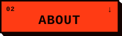</picture></a><a href="#user-content-stack"><picture><source media="(prefers-color-scheme: dark)" srcset="assets/buttons/stack-night.svg">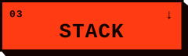</picture></a><a href="#user-content-work"><picture><source media="(prefers-color-scheme: dark)" srcset="assets/buttons/work-night.svg">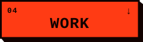</picture></a><a href="#user-content-activity"><picture><source media="(prefers-color-scheme: dark)" srcset="assets/buttons/activity-night.svg"></picture></a><a href="#user-content-play"><picture><source media="(prefers-color-scheme: dark)" srcset="assets/buttons/play-night.svg">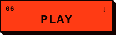</picture></a><a href="#user-content-contact"><picture><source media="(prefers-color-scheme: dark)" srcset="assets/buttons/contact-night.svg">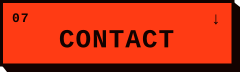</picture></a>

<!-- RECORD:START -->

<picture><source media="(prefers-color-scheme: dark)" srcset="assets/about-night.svg"></picture>
<a href="#user-content-internship"><picture><source media="(prefers-color-scheme: dark)" srcset="assets/about-intern-night.svg"></picture></a>
<a href="#user-content-education"><picture><source media="(prefers-color-scheme: dark)" srcset="assets/about-btech-night.svg"></picture></a>
<picture><source media="(prefers-color-scheme: dark)" srcset="assets/about-lead-night.svg"></picture>

<picture><source media="(prefers-color-scheme: dark)" srcset="assets/internship-night.svg"></picture>
<a href="https://github.com/ishaans04/EnterpriseGPT"><picture><source media="(prefers-color-scheme: dark)" srcset="assets/internship-1-night.svg"></picture></a>
<picture><source media="(prefers-color-scheme: dark)" srcset="assets/internship-2-night.svg"></picture>
<a href="https://github.com/ishaans04/Face-Recognition"><picture><source media="(prefers-color-scheme: dark)" srcset="assets/internship-3-night.svg"></picture></a>
<picture><source media="(prefers-color-scheme: dark)" srcset="assets/internship-end-night.svg"></picture>

<picture><source media="(prefers-color-scheme: dark)" srcset="assets/education-night.svg"></picture>
<!-- RECORD:END -->

<!-- STACK:START -->

<picture><source media="(prefers-color-scheme: dark)" srcset="assets/stack-night.svg"></picture>

<picture><source media="(prefers-color-scheme: dark)" srcset="assets/stack-hive-night.svg"></picture>

<!-- STACK:END -->

<a href="https://github.com/ishaans04/Square-One"><picture><source media="(prefers-color-scheme: dark)" srcset="assets/work-square-one-night.svg"></picture></a>
<a href="https://github.com/ishaans04/SENTRA"><picture><source media="(prefers-color-scheme: dark)" srcset="assets/work-sentra-night.svg"></picture></a>
<a href="https://github.com/ishaans04/Ratchet"><picture><source media="(prefers-color-scheme: dark)" srcset="assets/work-ratchet-night.svg"></picture></a>
<a href="https://github.com/ishaans04/Recoup"><picture><source media="(prefers-color-scheme: dark)" srcset="assets/work-recoup-night.svg"></picture></a>
<a href="https://github.com/ishaans04/HAVEN-august2026"><picture><source media="(prefers-color-scheme: dark)" srcset="assets/work-haven-night.svg"></picture></a>
<a href="https://github.com/ishaans04/Jury"><picture><source media="(prefers-color-scheme: dark)" srcset="assets/work-jury-night.svg"></picture></a>

<a href="https://squareone-eight.vercel.app/"><picture><source media="(prefers-color-scheme: dark)" srcset="assets/buttons/square-one-night.svg"></picture></a> <a href="https://havenaugust2026.vercel.app/"><picture><source media="(prefers-color-scheme: dark)" srcset="assets/buttons/haven-night.svg"></picture></a>

<b>#07 – #16 · The other 10 projects</b>

 

- `#07` **[GROOT](https://github.com/ishaans04/Groot)** · Natural language in. Intelligence missions out.
- `#08` **[Ripple](https://github.com/ishaans04/Ripple)** · Twitch chat shapes evolution: mutations, selection and a live OBS overlay.
- `#09` **[CareGrid](https://github.com/ishaans04/CareGrid)** · Campus emergency response with incident agents and live dispatch.
- `#10` **[EnterpriseGPT](https://github.com/ishaans04/EnterpriseGPT)** · Agentic compliance platform grounded in approved knowledge and connected workflows.
- `#11` **[SQLMind Agent](https://github.com/ishaans04/SQLMind-Agent)** · Natural-language SQL, analytics and generated dashboards.
- `#12` **[SQLMind MCP](https://github.com/ishaans04/SQLMind-MCP)** · Read-only SQL across multiple databases through MCP.
- `#13` **[Volt](https://github.com/ishaans04/Volt)** · EV charging slots optimised with dynamic programming and min-cost flow.
- `#14` **[Face Recognition](https://github.com/ishaans04/Face-Recognition)** · Facial embeddings for identity verification with InsightFace.
- `#15` **[Lumina](https://github.com/ishaans04/Lumina)** · Notes, PDF summaries and multi-model chat in one writing space.
- `#16` **[Student Management System](https://github.com/ishaans04/Student-Management-System)** · Desktop client-server records app in Java.

[All repositories ↗](https://github.com/ishaans04?tab=repositories)

<picture><source media="(prefers-color-scheme: dark)" srcset="assets/activity-night.svg"></picture>
<picture><source media="(prefers-color-scheme: dark)" srcset="assets/skyline-night.svg"></picture>

<!-- ACTIVITY:START -->

Refreshed daily from public GitHub data · last refresh 2026-11-28 UTC · <a href="assets/activity.json">raw data</a>

<!-- ACTIVITY:END -->

<picture><source media="(prefers-color-scheme: dark)" srcset="assets/play-night.svg"></picture>

<!-- TEACH:START -->

 
 
 
 
 

Seeded with 4 points. Your move. 
4 points · 1 teacher · 1 training round · loss 0.0001

<!-- TEACH:END -->

<a href="mailto:sharmaishaaan04@gmail.com"><picture><source media="(prefers-color-scheme: dark)" srcset="assets/contact-night.svg"></picture></a>

<a href="mailto:sharmaishaaan04@gmail.com"><picture><source media="(prefers-color-scheme: dark)" srcset="assets/buttons/email-night.svg"></picture></a> <a href="https://www.linkedin.com/in/ishaan-sharma04/"><picture><source media="(prefers-color-scheme: dark)" srcset="assets/buttons/linkedin-night.svg">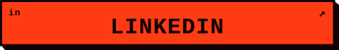</picture></a>

