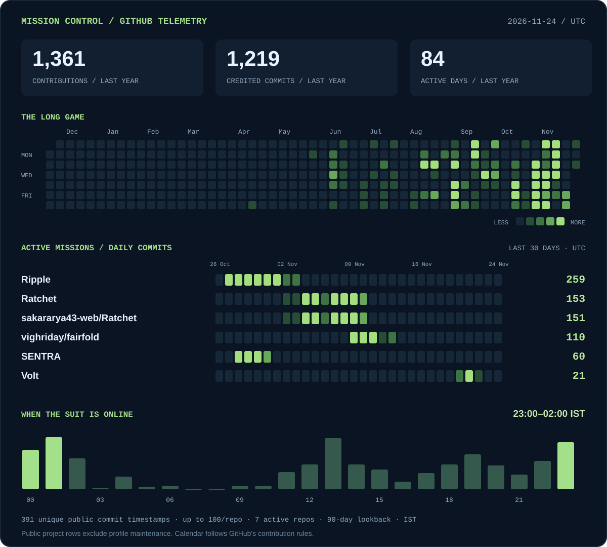

<a href="#user-content-the-arsenal">Arsenal</a> &nbsp; / &nbsp; <a href="#user-content-featured-missions">Featured missions</a> &nbsp; / &nbsp; <a href="#user-content-mission-control">Mission control</a> &nbsp; / &nbsp; <a href="#user-content-open-a-channel">Open a channel</a>

I build **agentic AI, safety systems, and full-stack products** where you can trace the evidence and understand what happens next. I care about the whole system: the model, the guardrails, and the person using it.

**B.Tech, Information Technology · MSIT** &nbsp; | &nbsp; Previously **Agentic AI Intern at IDCUBE**

## The arsenal

| Capability | Tools I work with |
| :--- | :--- |
| **Languages** | Python · TypeScript · JavaScript · Go · SQL · Java · C++ |
| **AI & orchestration** | Agentic AI · Multi-agent systems · RAG · LangGraph · LangChain · MCP · Pydantic AI |
| **Applications** | FastAPI · React · Node.js |
| **Data** | PostgreSQL · Neon · MongoDB · SQLite · pgvector |
| **Delivery** | Docker · GitHub Actions · Vercel · Git |

## Featured missions

### [Square One](https://github.com/ishaans04/Square-One) · Learn it. Play it. Prove it.

**Winner, Horizon Hackathon by Hoollow (2026) — first attempt, first win.** Turn any skill into a playable **3D fort of 20 rooms**, with adaptive placement and questions built around common mistakes. English, Hindi, and Hinglish support; a prompt cache makes repeat skill generation cost zero LLM calls.

`JavaScript` `React` `Node.js` `Gemini` `Neon / PostgreSQL` `Vercel`

**[Play in your browser ↗](https://squareone-eight.vercel.app/)** &nbsp; · &nbsp; [Explore the source](https://github.com/ishaans04/Square-One)

<table>
<tr>
<td width="50%" valign="top">

### [Recoup](https://github.com/ishaans04/Recoup)

**Recovery is a state machine.** A revenue recovery agent for Razorpay: diagnose failed payments, execute bounded recovery actions, and preserve an append-only audit trail.

`Python` `FastAPI` `Groq` `SQLite`

[Inspect the recovery engine ↗](https://github.com/ishaans04/Recoup)

</td>
<td width="50%" valign="top">

### [HAVEN](https://github.com/ishaans04/HAVEN-august2026)

**The human owns the decision.** A fatigue-aware safety co-pilot for space crews. AI proposes; deterministic checks evaluate procedures and risks before a human director makes the call.

`Python` `LangChain` `IBM watsonx.ai`

[Open the demo ↗](https://havenaugust2026.vercel.app/) · [Source](https://github.com/ishaans04/HAVEN-august2026)

</td>
</tr>
<tr>
<td width="50%" valign="top">

### [The Jury](https://github.com/ishaans04/Jury)

**Don't build it. Prove it.** Five specialist investigators test startup assumptions against cited evidence. A deterministic jury rules on the record — and can refuse to rule when evidence is thin.

`Python` `FastAPI` `LangGraph` `React` `pgvector`

[Examine the evidence ↗](https://github.com/ishaans04/Jury)

</td>
<td width="50%" valign="top">

### The engineering thread

**Useful intelligence should be inspectable.** Learning, recovery, human decisions, and evidence: different products, the same standard.

The wider collection explores agent containment, permission boundaries, live systems, and developer tools.

[Browse all repositories ↗](https://github.com/ishaans04?tab=repositories)

</td>
</tr>
</table>

<b>ASSEMBLE THE REST — open the project archive</b>

 

| Project | The mission | Stack |
| :--- | :--- | :--- |
| **[SENTRA](https://github.com/ishaans04/SENTRA)** | Contain unsafe agent behavior, pause only affected work, and recover through voice-guided instructions. | Python · FastAPI · MCP · React |
| **[RATCHET](https://github.com/ishaans04/Ratchet)** | Check what permission changes make reachable; enforce approvals and preserve an auditable record. | Go · PostgreSQL · OPA · NATS · React |
| **[GROOT](https://github.com/ishaans04/Groot)** | Turn natural-language business requests into structured, source-backed intelligence missions. | Python · FastAPI |
| **[Ripple](https://github.com/ishaans04/Ripple)** | Let Twitch chat shape evolution: mutations, natural selection, and a live OBS overlay. | TypeScript · Fastify · PostgreSQL |
| **[CareGrid](https://github.com/ishaans04/CareGrid)** | Coordinate campus emergency response with incident agents, live dispatch, and Proof-of-Response. | Flutter · Dart · Serverpod |
| **[EnterpriseGPT](https://github.com/ishaans04/EnterpriseGPT)** | Ground enterprise compliance agents in approved knowledge and connected workflows. | RAG · API integrations · React |
| **[SQLMind Agent](https://github.com/ishaans04/SQLMind-Agent)** | Explore databases through natural-language SQL, analytics, and generated dashboards. | Python · MCP · NVIDIA NIM |
| **[SQLMind MCP](https://github.com/ishaans04/SQLMind-MCP)** | Discover schemas and run read-only SQL across multiple databases through MCP. | Python · SQLite · MySQL · PostgreSQL |
| **[Volt](https://github.com/ishaans04/Volt)** | Optimize EV charging slots with dynamic programming and min-cost flow. | JavaScript · Graph algorithms |
| **[Face Recognition](https://github.com/ishaans04/Face-Recognition)** | Extract facial embeddings for biometric identity verification. | Python · InsightFace · ArcFace |
| **[Lumina](https://github.com/ishaans04/Lumina)** | Bring notes, PDF summaries, and multi-model chat into a writing workspace. | Python · LLM integrations |
| **[Student Management System](https://github.com/ishaans04/Student-Management-System)** | Manage student records in a desktop client-server application. | Java · Swing · JDBC · MySQL |

[Explore the complete repository collection ↗](https://github.com/ishaans04?tab=repositories)

## Mission control

<!-- ACTIVITY:START -->
**Last telemetry refresh:** 2026-11-25 UTC · [Activity source](assets/activity.json)

<b>Open the daily mission log — public commits by project</b>

Dates follow GitHub contribution days (UTC). Each cell is the number of credited commits.

| Public project | 11-19 | 11-20 | 11-21 | 11-22 | 11-23 | 11-24 | 11-25 | 30-day total |
| :--- | ---: | ---: | ---: | ---: | ---: | ---: | ---: | ---: |
| [Ripple](https://github.com/ishaans04/Ripple) | 0 | 0 | 0 | 0 | 0 | 0 | 0 | 259 |
| [Ratchet](https://github.com/ishaans04/Ratchet) | 0 | 0 | 0 | 0 | 0 | 0 | 0 | 153 |
| [sakararya43-web/Ratchet](https://github.com/sakararya43-web/Ratchet) | 0 | 0 | 0 | 0 | 0 | 0 | 0 | 151 |
| [vighriday/fairfold](https://github.com/vighriday/fairfold) | 0 | 0 | 0 | 0 | 0 | 0 | 0 | 110 |
| [SENTRA](https://github.com/ishaans04/SENTRA) | 0 | 0 | 0 | 0 | 0 | 0 | 0 | 60 |
| [Volt](https://github.com/ishaans04/Volt) | 0 | 4 | 16 | 1 | 0 | 0 | 0 | 21 |
| [CareGrid](https://github.com/ishaans04/CareGrid) | 0 | 9 | 0 | 0 | 0 | 0 | 0 | 9 |

<!-- ACTIVITY:END -->

Refreshed daily from GitHub. Project rows show credited public-repository commits over the last 30 days, excluding this profile repository. The time-of-day view uses a labeled sample of public commit timestamps.

## Open a channel

<b><a href="mailto:sharmaishaaan04@gmail.com">sharmaishaaan04@gmail.com</a></b>  
<a href="https://www.linkedin.com/in/ishaan-sharma04/">LinkedIn ↗</a> &nbsp; / &nbsp; <a href="https://github.com/ishaans04?tab=repositories">Repositories ↗</a>

Bring the problem. I'll bring the curiosity, the code, and the receipts.

Character renders: <a href="assets/ARTWORK.md">PNGimg & FreePNGimg · artwork credits</a>. Marvel characters © Marvel.

