<picture><source media="(prefers-color-scheme: dark)" srcset="assets/hero-night.svg"></picture>

<a href="#about">About</a> · <a href="#stack">Stack</a> · <a href="#work">Work</a> · <a href="#activity">Activity</a> · <a href="#play">Play</a> · <a href="#contact">Contact</a>

<picture><source media="(prefers-color-scheme: dark)" srcset="assets/about-night.svg"></picture>

<picture><source media="(prefers-color-scheme: dark)" srcset="assets/stack-night.svg"></picture>

<a href="https://github.com/ishaans04/Square-One"><picture><source media="(prefers-color-scheme: dark)" srcset="assets/work-square-one-night.svg"></picture></a>
<a href="https://github.com/ishaans04/SENTRA"><picture><source media="(prefers-color-scheme: dark)" srcset="assets/work-sentra-night.svg"></picture></a>
<a href="https://github.com/ishaans04/Ratchet"><picture><source media="(prefers-color-scheme: dark)" srcset="assets/work-ratchet-night.svg"></picture></a>
<a href="https://github.com/ishaans04/Recoup"><picture><source media="(prefers-color-scheme: dark)" srcset="assets/work-recoup-night.svg"></picture></a>
<a href="https://github.com/ishaans04/HAVEN-august2026"><picture><source media="(prefers-color-scheme: dark)" srcset="assets/work-haven-night.svg"></picture></a>
<a href="https://github.com/ishaans04/Jury"><picture><source media="(prefers-color-scheme: dark)" srcset="assets/work-jury-night.svg"></picture></a>

<b><a href="https://squareone-eight.vercel.app/">Play Square One ↗</a></b> · <a href="https://havenaugust2026.vercel.app/">HAVEN demo ↗</a>

<b>#07 – #16 · The other 10 projects</b>

 

- `#07` **[GROOT](https://github.com/ishaans04/Groot)** · Natural language in. Intelligence missions out.
- `#08` **[Ripple](https://github.com/ishaans04/Ripple)** · Twitch chat shapes evolution: mutations, selection and a live OBS overlay.
- `#09` **[CareGrid](https://github.com/ishaans04/CareGrid)** · Campus emergency response with incident agents and live dispatch.
- `#10` **[EnterpriseGPT](https://github.com/ishaans04/EnterpriseGPT)** · Agentic compliance platform grounded in approved knowledge and connected workflows.
- `#11` **[SQLMind Agent](https://github.com/ishaans04/SQLMind-Agent)** · Natural-language SQL, analytics and generated dashboards.
- `#12` **[SQLMind MCP](https://github.com/ishaans04/SQLMind-MCP)** · Read-only SQL across multiple databases through MCP.
- `#13` **[Volt](https://github.com/ishaans04/Volt)** · EV charging slots optimised with dynamic programming and min-cost flow.
- `#14` **[Face Recognition](https://github.com/ishaans04/Face-Recognition)** · Facial embeddings for identity verification with InsightFace.
- `#15` **[Lumina](https://github.com/ishaans04/Lumina)** · Notes, PDF summaries and multi-model chat in one writing space.
- `#16` **[Student Management System](https://github.com/ishaans04/Student-Management-System)** · Desktop client-server records app in Java.

[All repositories ↗](https://github.com/ishaans04?tab=repositories)

<picture><source media="(prefers-color-scheme: dark)" srcset="assets/activity-night.svg"></picture>

<!-- ACTIVITY:START -->

Refreshed daily from public GitHub data · last refresh 2026-11-24 UTC · <a href="assets/activity.json">raw data</a>

<!-- ACTIVITY:END -->

<picture><source media="(prefers-color-scheme: dark)" srcset="assets/play-night.svg"></picture>

<!-- TEACH:START -->

 
 
 
 
 

Seeded with 4 points. Your move. 
4 points · 1 teachers · 1 training rounds · loss 0.0001

<!-- TEACH:END -->

<a href="mailto:sharmaishaaan04@gmail.com"><picture><source media="(prefers-color-scheme: dark)" srcset="assets/contact-night.svg"></picture></a>

<b><a href="mailto:sharmaishaaan04@gmail.com">sharmaishaaan04@gmail.com</a></b> · <b><a href="https://www.linkedin.com/in/ishaan-sharma04/">LinkedIn ↗</a></b>

